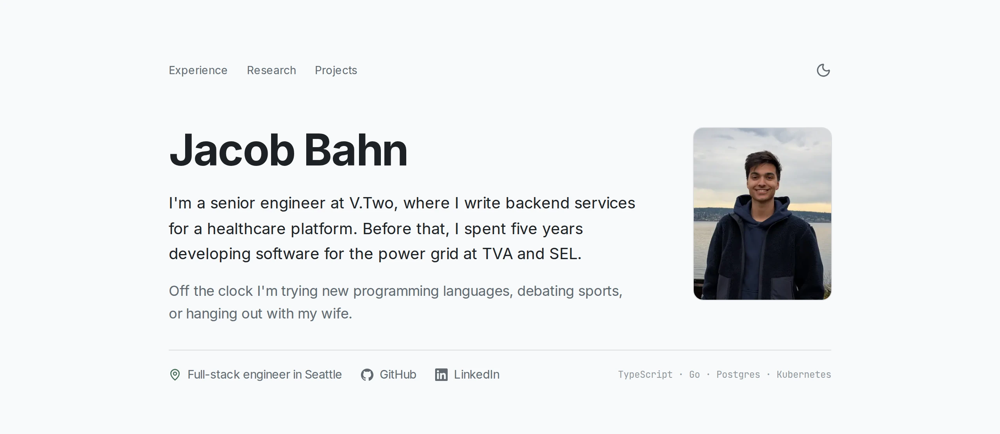

# [jacobbahn.com](https://jacobbahn.com)

Personal portfolio site showcasing my experience, research, and projects.

<picture>
  <source media="(prefers-color-scheme: dark)" srcset=".github/assets/home-dark.webp">
  
</picture>

## Projects

| Project | Description |
| --- | --- |
| [AI Overview for SearXNG](https://github.com/jacobabahn/ai-overview-searxng) | Streaming AI summaries with source citations for SearXNG, using local models or hosted providers |
| [JJ Evolved](https://github.com/jacobabahn/jj-evolved) | A keyboard-driven terminal interface for Jujutsu, with visual previews for editing revision history |
| [GitBarn Web Portal](https://github.com/Bahnstar/gitbarn-web) | A customer portal for manure removal services, bringing orders, billing documents, and support together |
| [PetitionU](https://github.com/bahnstar/petitionu) | A petition management platform for university students, professors, and administrators |
| [sLox](https://github.com/jacobabahn/sLox) | Lox language interpreter written in Scala |
| [Page Replacement Simulator](https://github.com/jacobabahn/PageReplacementSimulator) | An interactive view of FIFO, LIFO, and LRU page replacement, with cache states and hit/miss statistics |

## Research

- [Machine Learning Classification of Fossilized *Pectinodon bakkeri* Teeth](https://doi.org/10.3390/make7020045) ([code](https://github.com/jacobabahn/MicrofossilResearch)): using tooth measurements to group fossil specimens and train an image classifier, published in *Machine Learning and Knowledge Extraction* (2025)

## Tech Stack

- **Framework**: Next.js 16 (App Router)
- **Library**: React 19
- **Styling**: Tailwind CSS 4
- **Typography**: Inter, JetBrains Mono
- **Deployment**: Netlify
